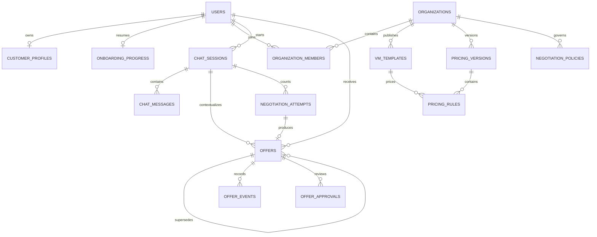
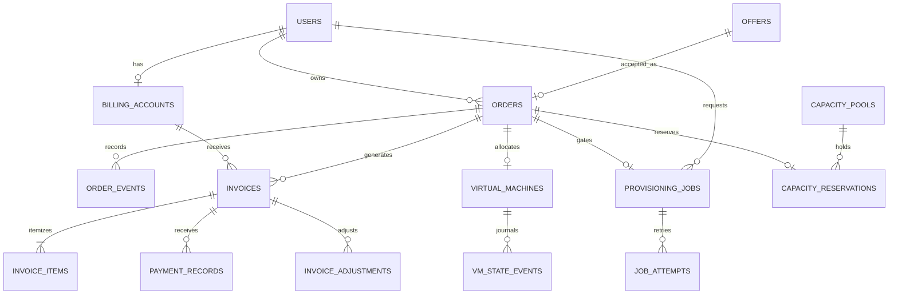
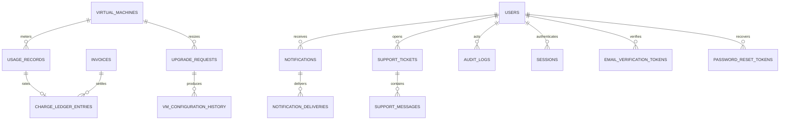

# Implemented database ERD

These three Mermaid ERDs are the maintained domain-level view of the physical
schema. Full column types, checks, foreign keys, deletion actions and indexes
are in the [data dictionary](data-dictionary.md). The diagrams are split by
domain so reviewers can read the relationships without turning the full
database into an unreadable wall of boxes.

## Identity, catalog and negotiation

## Commerce, billing and provisioning gate

## Runtime, support and reliability

The diagrams are intentionally domain-level. The full physical column and
foreign-key inventory is in the data dictionary, while the actual SQL remains
authoritative in `database/migrations/`.

The CP-07 physical additions are `billing_periods` and the `rated_at` and
`source_key` fields. `billing_periods.invoice_id` links one canonical recurring
period to one invoice; usage evidence links to a composite compute ledger row.
